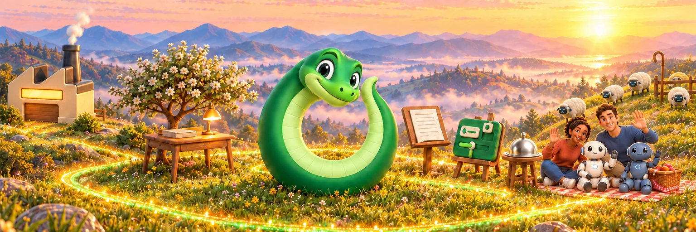

  

# Ourostack GitHub profile

This repository holds the [organization profile](profile/README.md) and shared GitHub brand images.

The rich renders are the primary marks. Use one-colour silhouettes only for tiny placements and outline needs.

- `brand/ouro.png`: approved Ouro rich render, with its background removed.
- `brand/desk.png`: approved empty wooden Desk render, with its background removed.
- `brand/ouro-hx.png`: approved Ouro HX render: a human uses an interface while an agent builds it.
- `brand/ouro-md.png`: the existing native icon from `ourostack/ouro-md/Resources/AppIcon.png`, unchanged.
- `brand/shepherd.png`: Ouro Shepherd render, Ouro with a shepherd's staff, accepted for current use.
- `brand/friends.png`: Friends render, Ouro with two people and two robots; Friends and Friends Relay share it.
- `brand/factory.png`: Factory render, a warm ochre factory.
- `brand/headers/`: full-width scene headers for the organization profile and each repository README, all set in one storybook world at dawn: Ouro on its glowing trail with each product. `ourostack.webp` is the profile hero; each other file is named after its product or repository. They aren't reviewed by Ari yet.
- `brand/provenance.json`: source, approval scope and copied-byte hashes; for each header, the prompt, reference images and model that drew it.

Ouro UI is the parent; Ouro HX is its component library under construction. No approved Ouro AX mark is claimed here.
