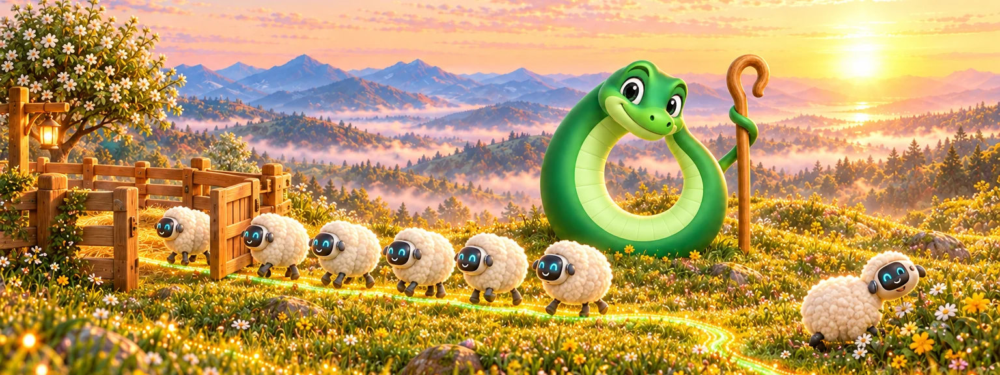
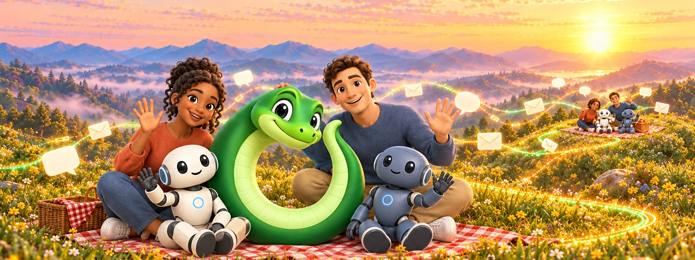
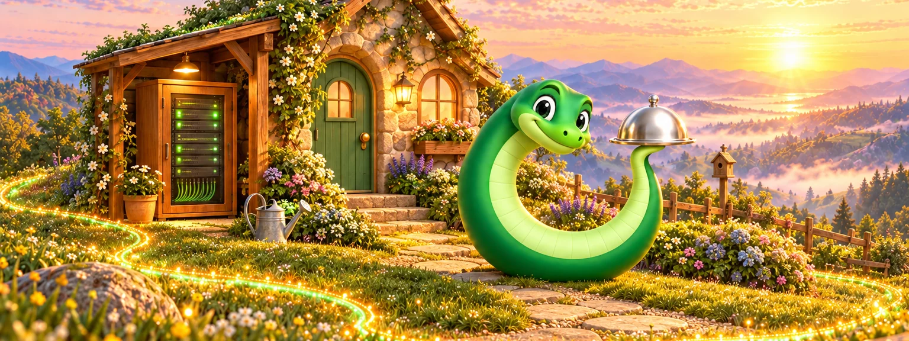
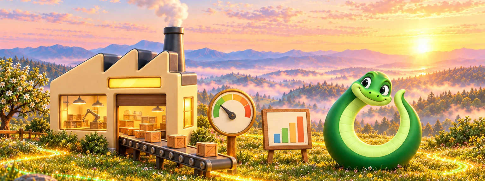

  

# Ourostack

[ouroboros.bot](https://ouroboros.bot)

| Desk | Ouro HX |
| :---: | :---: |
|  |  |
| Where agents keep their work, with Crew for teams | Components for humans and the agents building with them; under construction |

| Ouro MD | Ouroboros |
| :---: | :---: |
|  |  |
| A Mac Markdown editor for reading what agents write | The agent harness where it all started |

| Ouro Shepherd | Friends |
| :---: | :---: |
|  |  |
| Keeps agents on task; experimental, in Ouroboros | Who agents know, and how they reach each other |

| Ouro Butler | Factory |
| :---: | :---: |
|  |  |
| Looks after a home server; not open yet | Agent work, measured in public |
